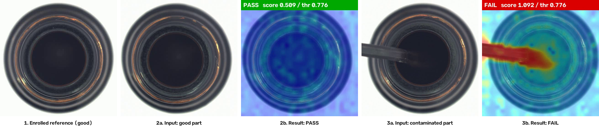

# Few-Shot Anomaly Detection for Video

Flags defective, wrong or missing parts from a handful of good reference images, with no training. Enrol 3–15 good images (or good frames of a video), run over a video, and get a PASS/FAIL verdict and a heatmap per frame.

How it works: DINOv2 ViT-S/14 (448 px) turns each frame into patch features. Each patch is scored by its nearest-neighbour distance to the enrolled reference bank, and the frame score is the worst patch. The threshold is automatic: mean + 3·std of leave-one-out scores over the reference set (a fixed fallback applies below 3 images). The model is exported to ONNX, so runtime needs only onnxruntime, OpenCV and NumPy; PyTorch is only needed for the export.

*Frames from the demo run. The detector is enrolled on good reference images (1), then each input frame is compared against them. A good part (2a) scores under the threshold and passes (2b). A contaminated part (3a) scores over it and fails, and the heatmap shows where (3b). Images are from MVTec-AD (CC BY-NC-SA 4.0, non-commercial use).*

## Quick start

    uv sync && uv run export_onnx.py                                       # 1. setup (one-time ONNX export; torch is dev-only)
    uv run detect.py enroll demo/reference_folder                          # 2. enrol: a folder of 3-15 good images ...
    uv run detect.py enroll --from-video clip.mp4 --frames 0-6.4s --n 8    #    ... or good frames of a video (or --frames 1,2.5,4)
    uv run detect.py run clip.mp4 --out out.mp4 --log out.csv              # 3. run: annotated video + CSV log + summary

`run` options: `--every k` scores every k-th frame; `--smooth k` reports FAIL only after k consecutive raw FAILs (off by default; the log keeps `raw_verdict`). There are no threshold-tuning flags. `enroll --backend wrn224` selects a WideResNet comparison backend (needs `uv run export_resnet.py`).

## Results

On a 320-frame demo video built from MVTec-AD (laptop CPU, 8 threads, 8 enrolled frames): 0.62 s per scored frame (1.6 FPS end to end), wrong or missing parts caught 100%, and on the bottle category 9.7% false alarms and 6.3% misses. Subtle defects are the weak spot: 34–43% missed on transistor and hazelnut. Full numbers, method and limits are in [docs/video-results.md](docs/video-results.md). The demo uses still images with synthetic jitter, not real camera footage.

## Reproducing the demo

`uv run fetch_mvtec.py` then `uv run make_demo_video.py --category bottle --out demo` builds a video and `*_labels.csv` from MVTec-AD (CC BY-NC-SA, non-commercial use only). `uv run eval_video.py out.csv demo/bottle_labels.csv` scores a run against the labels. `uv run selfcheck.py` checks the threshold logic.

## Not in this repo
- `models/*.onnx` (85 MB): run `uv run export_onnx.py` once to create it.
- `demo/*.mp4`: derived from MVTec-AD; rebuild as above. The labels and log CSVs are included.
